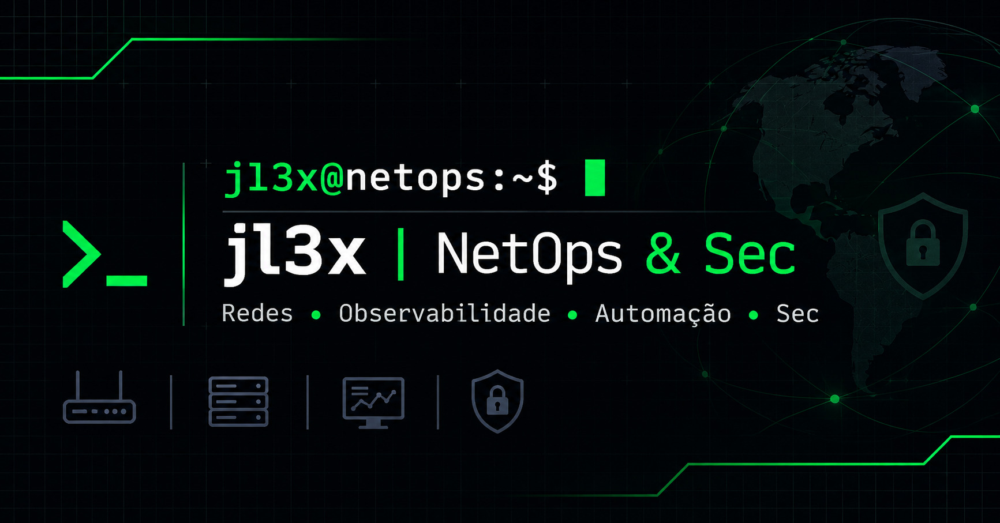

# jl3x@netops



Blog pessoal e anotações técnicas sobre redes, infraestrutura e tecnologia.

Construído com [Astro](https://astro.build/) baseado no tema [AstroPaper](https://github.com/satnaing/astro-paper) e hospedado no GitHub Pages.

## Estrutura Principal

- `src/content/posts/` — Posts do blog (`.md` ou `.mdx`)
- `src/content/pages/` — Páginas estáticas (ex: `about.md`)
- `astro-paper.config.ts` — Configurações do site
- `src/i18n/` — Textos e traduções da interface

## Comandos

```bash
pnpm install   # Instala as dependências
pnpm dev       # Roda localmente em localhost:4321
pnpm build     # Gera o build final e o índice de busca (Pagefind)
